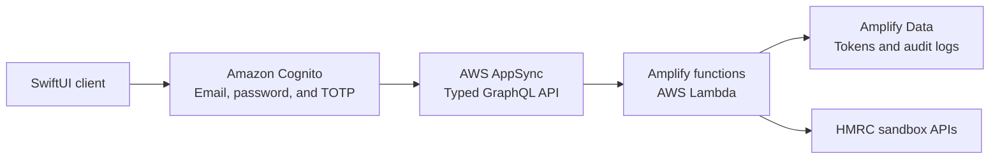

# BulBul SEQS — Amplify Backend

An AWS Amplify Gen 2 backend for BulBul SEQS, providing secure authentication and typed GraphQL operations for HMRC Making Tax Digital workflows.

The backend uses Amazon Cognito, AWS AppSync, Lambda, and Amplify Data to handle HMRC OAuth tokens, business data, obligations, and self-employment cumulative summaries. It targets HMRC's sandbox by default and is designed to be consumed by the companion SwiftUI application.

The SwiftUI app that uses it is [BulBul-SEQS-SwiftUI-Frontend](https://github.com/VitalJeevanjot/BulBul-SEQS-SwiftUI-Frontend).

## What it provides

| Area | Capabilities |
| --- | --- |
| Authentication | Email/password sign-in with required TOTP multi-factor authentication |
| HMRC OAuth | Authorization-code exchange, refresh-token exchange, token-status checks, and audit logs |
| Businesses | Create a sandbox test business, list businesses, and retrieve business details |
| Obligations | Retrieve income and expenditure obligations and final declaration obligations |
| Cumulative summaries | Put and retrieve consolidated or non-consolidated self-employment summaries |
| API safety | Typed AppSync contracts, request validation, structured HMRC errors, and correlation IDs |
| Verification | Node test suite for shared HMRC clients plus strict TypeScript checking |

## Architecture



Every custom GraphQL operation requires an authenticated Cognito user. Lambda handlers retrieve the current user's stored HMRC token, validate inputs, call the appropriate HMRC endpoint, and return a typed success or error result.

## Project structure

```text
amplify/
├── auth/resource.ts             # Cognito and required TOTP MFA
├── data/
│   ├── resource.ts              # Models and GraphQL operations
│   └── custom-types.ts          # Typed API payloads and results
├── functions/
│   ├── <operation>/
│   │   ├── handler.ts           # Thin AppSync/Lambda adapter
│   │   └── resource.ts          # Function configuration and secrets
│   └── shared/                  # HMRC clients, validation, types, and tests
└── backend.ts                   # Backend composition
docs/
└── progress-note.md             # Earlier implementation checkpoint
```

## Prerequisites

- Node.js `18.19+`, `20.6+`, or `22+`
- npm
- AWS CLI v2
- An AWS account with permission to deploy an Amplify sandbox
- An AWS CLI profile, preferably configured with IAM Identity Center (SSO)
- HMRC Developer Hub sandbox application credentials
- The companion frontend if you want to generate configuration directly into the SwiftUI project

## Setup

### 1. Clone and install

```bash
git clone https://github.com/VitalJeevanjot/BulBul-SEQS-Amplify-Backend.git
cd BulBul-SEQS-Amplify-Backend
npm ci
```

### 2. Configure AWS access

Create an AWS SSO profile if you do not already have one:

```bash
aws configure sso --profile <aws-profile>
```

Start an authenticated AWS session:

```bash
aws sso login --profile <aws-profile>
```

Replace `<aws-profile>` throughout this guide with your configured profile name.

### 3. Store the HMRC credentials

The client ID and secret are Amplify sandbox secrets. The CLI prompts for each value so credentials do not need to appear in a command or source file.

```bash
npx ampx sandbox secret set HMRC_CLIENT_ID --profile <aws-profile>
npx ampx sandbox secret set HMRC_CLIENT_SECRET --profile <aws-profile>
```

Do not commit HMRC credentials, OAuth tokens, `.env` files, or generated Amplify outputs.

### 4. Review the HMRC environment

The function resources use these defaults:

| Setting | Default | Purpose |
| --- | --- | --- |
| `HMRC_API_BASE_URL` | `https://test-api.service.hmrc.gov.uk` | HMRC sandbox API base URL |
| `HMRC_TOKEN_URL` | `https://test-api.service.hmrc.gov.uk/oauth/token` | OAuth token endpoint |
| `HMRC_REDIRECT_URI` | `com.jsv.bulbulseqs://hmrc-auth-callback` | SwiftUI deep-link callback |

Set an environment variable before starting the sandbox only when you need to override a default. Keep production and sandbox credentials strictly separate.

### 5. Validate locally

```bash
npm test
npm run typecheck
```

The tests mock HMRC network responses and cover success paths, malformed payloads, validation failures, protected headers, token refresh, and structured HMRC errors.

### 6. Deploy a development sandbox

```bash
npx ampx sandbox --profile <aws-profile>
```

To write `amplify_outputs.json` directly into the companion frontend, provide its configuration directory:

```bash
npx ampx sandbox \
  --outputs-out-dir "/absolute/path/to/frontend/BulBul-SEQS/AmplifyWorks" \
  --profile <aws-profile>
```

Wait for deployment to complete and for the CLI to confirm that the output file was written. The command then remains active as a local file watcher.

Press `Ctrl-C` to stop the watcher when you are finished. This stops only the local process and leaves the deployed AWS sandbox resources intact. Running `npx ampx sandbox delete` is a separate, destructive action and should be used only when you intentionally want to remove those resources.

## GraphQL operations

The generated Amplify client exposes these authenticated operations:

| Operation | Type | Purpose |
| --- | --- | --- |
| `changeToAccessToken` | Mutation | Exchange an HMRC authorization code and persist token metadata |
| `refreshAccessToken` | Mutation | Refresh the current user's HMRC access token |
| `getHmrcTokenStatus` | Query | Check HMRC sign-in state without exposing token values |
| `createTestBusiness` | Mutation | Create a business through HMRC Test Support |
| `listBusinesses` | Query | List businesses associated with a NINO |
| `retrieveBusinessDetails` | Query | Retrieve one business by business ID |
| `retrieveIncomeAndExpenditureObligations` | Query | Retrieve business income and expenditure obligations |
| `retrieveFinalDeclarationObligations` | Query | Retrieve final declaration obligations |
| `putSelfEmploymentCumulativeSummaryConsolidated` | Mutation | Submit a consolidated cumulative summary |
| `getSelfEmploymentCumulativeSummaryConsolidated` | Query | Retrieve a consolidated cumulative summary |
| `putSelfEmploymentCumulativeSummaryNonConsolidated` | Mutation | Submit a detailed cumulative summary |
| `getSelfEmploymentCumulativeSummaryNonConsolidated` | Query | Retrieve a detailed cumulative summary |

Optional `fraudPreventionHeaders` arguments are JSON-encoded objects, and `govTestScenario` can be used with supported HMRC sandbox scenarios.

## Security choices

- Cognito requires TOTP MFA and restricts first-factor authentication to passwords.
- HMRC client credentials are injected through Amplify secrets.
- Raw OAuth tokens are kept out of GraphQL results and application logs.
- OAuth audit records store token fingerprints and outcomes rather than token bodies.
- Shared clients validate identifiers, dates, tax years, monetary amounts, response shapes, and fraud-prevention headers.
- HMRC errors are normalized into typed results while preserving correlation IDs when available.

## How I used Codex to build this project (Codex Drafted Summary and I approve)

I used Codex as an engineering collaborator inside the repository, not as a one-shot code generator. The workflow was iterative:

1. **Establish context.** I gave Codex the backend requirements, repository rules, HMRC endpoint behavior, and the SwiftUI output location. Codex inspected the existing schema and function patterns before proposing changes.
2. **Build vertical slices.** Each HMRC capability was implemented as a complete slice: shared types and validation, an HMRC client, a thin Lambda handler, an Amplify function resource, and a typed GraphQL operation.
3. **Protect sensitive data.** I had Codex keep credentials in Amplify secrets, prevent raw tokens from reaching client responses or logs, and preserve only safe metadata and audit fingerprints.
4. **Test edge cases.** Codex added focused tests for successful HMRC responses, malformed responses, invalid NINOs and business IDs, tax-year rules, token refresh behavior, sandbox headers, and structured API errors.
5. **Verify every milestone.** After each feature group, Codex ran the complete test suite and strict TypeScript check, reviewed the Git diff, and fixed issues before committing.
6. **Keep the frontend contract current.** When schema or authentication changes affected the frontend, Codex deployed the Amplify sandbox, regenerated `amplify_outputs.json` in the SwiftUI project, and stopped the watcher without deleting AWS resources.
7. **Publish intentionally.** Codex summarized each coherent change in a reviewed commit and pushed it only after the local and cloud checks succeeded.

Example requests I used with Codex followed this pattern:

```text
Implement the next HMRC API operation using the existing shared-client pattern.
Add strict input and response validation, preserve structured HMRC errors,
write focused tests, run the full test suite and typecheck, then review the diff.
```

Codex accelerated code navigation, implementation, refactoring, testing, deployment checks, and documentation. I remained responsible for the product requirements, HMRC application configuration, credentials, security decisions, and final review of every change.

## Development workflow

Before publishing a backend change:

```bash
npm test
npm run typecheck
```

If the change modifies auth, data, functions, or generated frontend configuration, also deploy the sandbox with `--outputs-out-dir`, confirm `amplify_outputs.json` was written, and stop the watcher with `Ctrl-C`.

## License

This project is licensed under the ISC License as declared in `package.json`.
